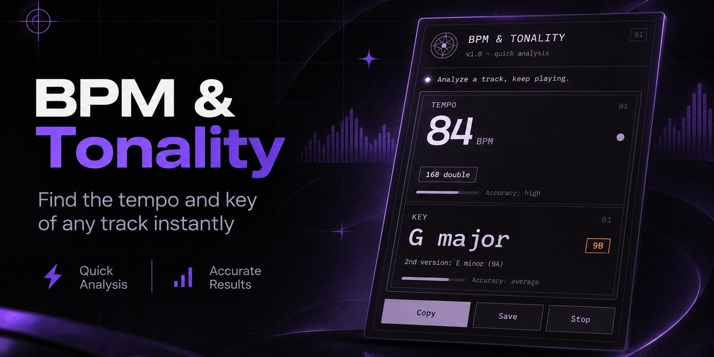
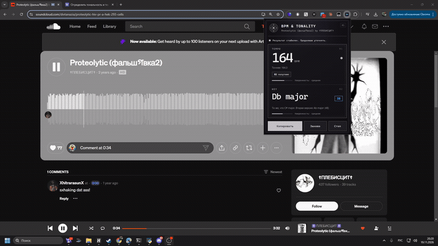

  

<h1 align="center">BPM & Tonality</h1>

<b>Find the tempo and key of any track instantly.</b>

  <a href="../../releases/latest"><b>⬇ Download</b></a> ·
  <a href="#-english">English</a> ·
  <a href="#-русский">Русский</a>

---

## 🇬🇧 English

Free Chrome extension that detects **BPM** and **musical key** of any audio playing in your browser tab: YouTube, SoundCloud and more. Playback is not affected.

### Features
- ⚡ Fast analysis while the track keeps playing
- 🎚 BPM with half/double-tempo detection (e.g. 84 / 168)
- 🎹 Key with an alternative version + Camelot notation (9B / 9A)
- 📋 Copy and Save results in one click
- 🆓 Free, no ads, no subscription

### Install
1. Download the ZIP from [Releases](../../releases/latest)
2. Unzip it to any folder
3. Open `chrome://extensions/` and turn on **Developer mode** (top right)
4. Drag the unzipped folder into the extensions window (or click **Load unpacked** and select it)

### Usage
Open a track → click the extension icon → analysis starts. Results show BPM, key and accuracy.

### Privacy
The extension collects **only anonymous install statistics** (a count of how many people use it). It does **not** collect or send audio, page URLs, track names, or personal data. Audio is analyzed locally in your browser.

### Feedback
Found a track it gets wrong? Open an [Issue](../../issues).

---

## 🇷🇺 Русский

Бесплатное расширение для Chrome, которое определяет **BPM** и **тональность** любого трека, играющего во вкладке: YouTube, SoundCloud и другие сайты. Воспроизведение не затрагивается.

### Возможности
- ⚡ Быстрый анализ, трек продолжает играть
- 🎚 BPM с учётом половинного/двойного темпа (например 84 / 168)
- 🎹 Тональность, альтернативная версия и нотация Camelot (9B / 9A)
- 📋 Копирование и сохранение результата в один клик
- 🆓 Бесплатно, без рекламы и подписок

### Установка
1. Скачайте ZIP со страницы [Releases](../../releases/latest)
2. Распакуйте в любую папку
3. Откройте `chrome://extensions/` и включите **Режим разработчика** (справа сверху)
4. Перетащите распакованную папку в окно расширений (или нажмите **Загрузить распакованное расширение** и выберите её)

### Как пользоваться
Откройте трек → нажмите на иконку расширения → начнётся анализ. Покажет BPM, тональность и точность.

### Конфиденциальность
Расширение собирает **только анонимную статистику установок** (сколько людей им пользуется). Оно **не** собирает и не отправляет аудио, адреса страниц, названия треков и персональные данные. Звук анализируется локально в браузере.

### Обратная связь
Нашли трек, где ошибается? Создайте [Issue](../../issues).
